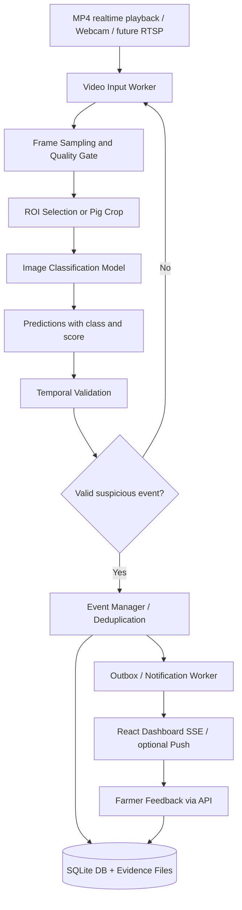

# PIG CV — PROJECT BRIEF & CLI AGENT TASKS

> Tài liệu giao việc cho AI CLI Agent (Claude Code, Codex CLI, Gemini CLI hoặc tương đương).  
> Ngôn ngữ giao tiếp và báo cáo: **Tiếng Việt**. Tên biến, mã nguồn và API: **tiếng Anh**.
> Trạng thái: **đề xuất triển khai**, không được hiểu là các module đã hoàn thành.

## 0. Vai trò và nguyên tắc vận hành của CLI Agent

Bạn là **Technical Lead + AI Engineer + Software Analyst** hỗ trợ nhóm sinh viên. Hãy khảo sát repository và dữ liệu thực tế trước khi thay đổi code. Ưu tiên **kế hoạch khả thi, có thể demo, có kiểm thử**, không tạo ra kết quả giả hoặc giả định một chức năng đã chạy.

**QUY TẮC BẮT BUỘC**

1. **Không xóa, di chuyển, đổi tên hoặc ghi đè ảnh gốc.** Mọi thao tác làm sạch phải tạo *manifest* và đề xuất `keep / quarantine / review`, chỉ copy sang thư mục mới sau khi người dùng duyệt.
2. Không tự tải hoặc phát tán toàn bộ dữ liệu. Không đưa thông tin tài khoản, RTSP password, token, khóa dịch vụ vào Git.
3. Không dựng accuracy, macro-F1, kết quả benchmark hoặc nhận định về bài báo nếu chưa đọc/xác minh. Phân biệt **paper nói gì**, **suy luận của agent**, và **đề xuất cho đồ án**.
4. Không tuyên bố model Classification định vị được heo bệnh trong ảnh đàn nếu chưa có bước chọn ROI hoặc model hỗ trợ; không kết luận thú y từ điểm Softmax.
5. Không huấn luyện mô hình tốn tài nguyên, cài dependency lớn hoặc thay DB thật khi chưa lập kế hoạch và được người dùng chấp thuận.
6. Nếu không thể truy cập PDF toàn văn, hãy ghi `FULL_TEXT_UNAVAILABLE`; chỉ tóm tắt phần được truy cập, không tự suy diễn chi tiết optimizer, epochs, hyperparameters.
7. Ghi đầy đủ nguồn, DOI, năm, URL, phần/đoạn làm căn cứ trong báo cáo; tôn trọng giấy phép dữ liệu, code, weights và paper.
8. Giữ trọng tâm **đồ án chuyên ngành Công nghệ phần mềm giữa khóa**, không biến dự án thành đề tài phát minh thuật toán mới.

## 1. Tổng quan dự án

- **Tên đề tài tạm:** Xây dựng hệ thống hỗ trợ phân loại dấu hiệu bệnh ngoài da trên heo bằng Deep Learning và cảnh báo gần thời gian thực.
- **English:** Deep Learning-Based Pig Skin Abnormality Classification and Near-Real-Time Alert System.
- **Nhóm:** 3 người (AI/Data, Backend/Video, Frontend/Testing).
- **Thời hạn:** Tổng cộng 10 tuần; lúc lên kế hoạch đang ở **tuần 2**, còn khoảng 8 tuần. Lấy tuần làm mốc, **không tự suy diễn ngày bảo vệ cụ thể**.
- **Dataset:** Khoảng **7.000 ảnh Image Classification**, đã tải về máy nhưng **chưa audit, lọc, thống kê, chia tập**. Chưa xác định số class, nhãn và góc ảnh thực tế — **bắt buộc kiểm tra**.
- **AI chính:** Image Classification bằng Transfer Learning; baseline nhẹ ưu tiên **MobileNetV2**, đối chứng **EfficientNet-B0** (có thể thử ResNet18 khi đủ thời gian).
- **Mục tiêu demo:** Nguồn video MP4 phát theo thời gian thực hoặc webcam; lựa chọn frame / vùng ảnh hợp lệ → phân loại → tổng hợp theo thời gian → tạo sự kiện → cảnh báo lên dashboard. Camera IP/RTSP là mở rộng, **chưa mua phần cứng**.
- **Đối tượng sử dụng:** Chủ hộ chăn nuôi. Quản trị viên chỉ khi có nhu cầu thực; dịch vụ push bên ngoài là actor phụ nếu dùng push.
- **Phạm vi KHÔNG CAM KẾT:** Tự chẩn đoán bệnh chính xác; xác định từng con trong đàn trên 20 con chỉ từ classifier; nhìn xuyên vùng khuất (móng, vú); tracking cá thể lâu dài; vận hành thương mại 24/7; multi-camera fusion.
- **Rủi ro lớn nhất:** Dataset ảnh Classification (có thể cận cảnh) không đồng phân bố với frame/ROI từ camera toàn chuồng. **Kiểm chứng bằng video thực tế từ tuần 4–5**.

## 2. Mục tiêu sản phẩm / tiêu chí nghiệm thu

### MVP bắt buộc

1. Đọc ảnh và video MP4; video chạy có đồng hồ/nhịp thời gian thực, không chỉ xử lý offline thật nhanh rồi gọi là realtime.
2. Pipeline Classification có preprocess và version model; lưu class, score, nhãn `uncertain/needs_review` khi không đủ tin cậy.
3. Khi dùng video đàn: có **ROI strategy rõ ràng** (crop từng con bằng detector pretrained nếu phù hợp hoặc vùng quan sát hạn chế). Nếu chưa khả thi phải nêu giới hạn/demo trên video ROI phù hợp.
4. Temporal validation **theo cùng đối tượng/vùng** khi có tracking; nếu không tracking được thì chỉ kết luận mức **ô chuồng / vùng khung hình**, tránh cộng dồn điểm từ các con khác nhau.
5. Event manager chống cảnh báo trùng, lưu ảnh bằng chứng và lịch sử; dashboard nhận cập nhật qua SSE/WebSocket.
6. Người dùng xem, xác nhận, dismiss sự kiện; lịch sử có phân quyền theo chủ trang trại.
7. Kiểm thử hệ thống, độ trễ xử lý, lỗi nguồn video, và báo cáo false alerts trên video có gán nhãn kiểm chứng.

### Phần mở rộng khi còn thời gian

- RTSP thực; push notification điện thoại; thêm baseline thứ ba; detector heo pretrained với tập test crop thật; nhiều ô chuồng.

### Không làm trong 8 tuần còn lại

- Xây model mới với attention/transformer phức tạp khi chưa có baseline; điều trị/đề xuất thuốc; nhận diện bệnh móng/vú bị che; tracking mã heo xuyên nhiều ngày; kiến trúc microservices/Kafka/Kubernetes.

## 3. Kiến trúc logic dự kiến

**Nguyên tắc kỹ thuật:** tách video worker khỏi request HTTP; inference không đợi HTTP notification; không lưu mỗi frame vào DB; lưu event + evidence; check camera stream health và hiển thị `monitoring unavailable` khác với `normal`.

### Stack tối giản (có thể thay nếu repository hiện hữu khác)

- Python, PyTorch + torchvision; OpenCV hoặc FFmpeg; FastAPI; SQLite (WAL khi có nhiều reader); React.
- SSE để gửi cảnh báo web; WebSocket chỉ khi thực sự cần kênh hai chiều; SQLite hợp lý cho MVP nhỏ, kiểm thử concurrent writes.
- Quản lý dependencies bằng lock file; chạy bằng 1 máy; không cần deploy cloud ngay.

## 4. Cơ sở dữ liệu và phạm vi nghiệp vụ

Có một bản thiết kế SQLite V3 từ trao đổi trước; **agent phải kiểm tra file/schema đang có trong repository**, không giả định V3 đã tồn tại hay production-ready.

Các khái niệm dự kiến: `users`, `farms`, `pens`, `cameras` hoặc `video_sources`, `model_versions`, `finding_types` hoặc `classification_labels`, `monitoring_events`, `event_findings` (chỉ nếu dùng bounding box), `alert_deliveries`, `event_feedback`, `push_devices` (chỉ nếu có push).

**Chú ý với Classification:** Nhãn bệnh/class của ảnh có thể không tương đương `finding_types` (nhóm dấu hiệu quan sát) → thiết kế mapping rõ; kết quả một ảnh không tự có bbox. Cân nhắc bảng `inference_samples`/`classification_results` cho upload thủ công hoặc debug có giới hạn; không ghi mọi video frame vào DB.

Phải kiểm tra: quyền sở hữu trại khi truy vấn, camera thuộc ô chuồng, timezone UTC, migrations, outbox transaction, retry, idempotency và retention ảnh.

## 5. Bài báo khoa học cần agent phân tích

Chỉ ưu tiên nguồn **Elsevier / ScienceDirect, IEEE Xplore, PLOS ONE**; bổ sung Cambridge Core cho nghiên cứu `Animal` về heo. Tất cả link dưới đây là đường dẫn nhà xuất bản / DOI đã được đối chiếu trước khi soạn brief. Một số toàn văn có paywall.

| ID | Paper (năm, nguồn) | Link | Vai trò chính |
|---|---|---|---|
| P1 | Dagne Walle Girmaw (2025), *Livestock animal skin disease detection and classification using deep learning approaches*, Biomedical Signal Processing and Control, Elsevier | https://doi.org/10.1016/j.bspc.2024.107334 ; https://www.sciencedirect.com/science/article/pii/S1746809424013922 | **Method paper chính**: Transfer Learning, MobileNetV2, DenseNet201, EfficientNetB7 trên bò/cừu/dê; 1.405 ảnh. KHÔNG mặc định hiệu quả trên heo. |
| P2 | J. Brünger et al. (2019), *‘Tailception’: using neural networks for assessing tail lesions on pictures of pig carcasses*, *Animal* (xuất bản online 2018, số tạp chí 2019) | https://doi.org/10.1017/S1751731118003038 ; https://www.cambridge.org/core/journals/animal/article/tailception-using-neural-networks-for-assessing-tail-lesions-on-pictures-of-pig-carcasses/57F1EE3D905C52E67EFB6A268FD5BAA6 | **Domain + ROI paper**: tìm vùng đuôi trước khi phân loại; trên ảnh thân thịt, không phải video chuồng. |
| P3 | A. Tajerian et al. (2023), *Design and validation of a new machine-learning-based diagnostic tool for the differentiation of dermatoscopic skin cancer images*, PLOS ONE | https://doi.org/10.1371/journal.pone.0284437 ; https://journals.plos.org/plosone/article?id=10.1371/journal.pone.0284437 | **Method/evaluation**: EfficientNet, phân loại 7 lớp ảnh da người, F1 theo lớp, ảnh dermoscopy khác RGB heo. |
| P4 | *Single Model Deep Learning on Imbalanced Small Datasets for Skin Lesion Classification* (2022), IEEE Transactions on Medical Imaging | https://doi.org/10.1109/TMI.2021.3136682 ; https://ieeexplore.ieee.org/document/9656127/ | **Optional improvement**: Dropout, DropBlock, Modified RandAugment, xử lý mất cân bằng; chỉ dùng nếu dataset thật sự lệch. |
| P5 | R. K. Singh et al. (2022), *SkiNet: A deep learning framework for skin lesion diagnosis with uncertainty estimation and explainability*, PLOS ONE | https://doi.org/10.1371/journal.pone.0276836 ; https://journals.plos.org/plosone/article?id=10.1371/journal.pone.0276836 | **Alert design inspiration**: uncertainty/explainability; không bắt buộc tái lập segmentation / toàn bộ framework. |

**Ưu tiên đọc sâu:** P1 → P2 → P5; đọc P3 để có thêm đối chứng Classification; P4 chỉ nếu imbalance/overfit thể hiện rõ. Không gọi P2/P5 là baseline CNN trực tiếp khi không tái triển khai chúng.

### OUTPUT được yêu cầu cho MỖI paper

Lưu `docs/research/papers/Px.md`, gồm:

1. Thông tin trích dẫn chuẩn: title, authors, venue, năm, DOI, URL, peer-reviewed? (xác minh), quyền truy cập toàn văn.
2. Câu hỏi nghiên cứu, đối tượng (heo/loài khác/người), loại ảnh (RGB/dermoscopy/video), quy mô và phân bố nhãn.
3. Quy trình: tiền xử lý, augmentation, mô hình, pretrained weights, loss, optimizer, learning rate, batch, epochs, data split, metrics. Với trường không tìm thấy: ghi **`NOT_REPORTED`**.
4. Kết quả thực nghiệm **có chỉ ra nguồn bảng/hình/trang**, hạn chế được tác giả nêu và hạn chế bạn suy luận (tách biệt).
5. Phần có thể áp dụng trực tiếp vào đồ án, phần không nên áp dụng, ước lượng mức độ khó/chi phí.
6. Phân biệt `related_work`, `architecture_baseline`, `method_reimplementation`, `deployment_inspiration`.
7. Link code/weights chính thức nếu thực sự tồn tại; kiểm tra giấy phép trước sử dụng.
8. Tóm tắt **tối đa 1 trang/paper**, có `Verified / Partially verified / Abstract only` và mức tin cậy cho từng nhận định.

Bổ sung `docs/research/literature_matrix.md` so sánh tất cả paper và `docs/research/decision.md` với lựa chọn **2 baseline đầu**, lý do và những gì chưa thể kết luận. **Không dùng Accuracy của paper khác dataset để xếp hạng model trên dataset heo.**

## 6. Kiểm toán dataset — VIỆC ƯU TIÊN SỐ 1

Agent PHẢI hỏi hoặc tìm đường dẫn dataset ở local repository; nếu không thấy, báo `DATASET_PATH_REQUIRED` chứ không bịa tên class.

Các công cụ không phá hủy audit/review/split được đặt riêng trong `E:\code\PigSkinResearchStudio\scripts`, ngoài repo DACN. Chúng đọc ảnh và chỉ xuất metadata/manifest; không tự xóa, di chuyển hoặc sửa ảnh. Báo cáo dataset của đồ án vẫn nằm ở `docs/dataset_report.md`.

Baseline split đề xuất 70/15/15 **không phải luật cứng**. Augmentation **chỉ Train**; tránh hue shift mạnh làm thay đổi nhãn da đỏ/tím. Test độc lập không dùng để chọn hyperparameter.

### Kiểm tra quan trọng trước khi bắt đầu realtime

Lấy mẫu ảnh của dataset và một ít video heo thật (nếu có) để trả lời: ảnh dataset là cận cảnh, toàn thân, hay nhiều heo? Nếu không có video, ghi `VIDEO_DATA_UNAVAILABLE`. Không khẳng định realtime hoạt động trên ô chuồng hơn 20 con nếu chưa có đánh giá video và ROI thực tế.

## 7. Huấn luyện baseline & đánh giá

- Vòng 1: MobileNetV2 ImageNet pretrained → thay classification head theo số class thực tế → fine-tune.
- Vòng 2: EfficientNet-B0 ImageNet pretrained → pipeline tương đương; **B0 khác B7 trong P1**, ghi rõ đây là điều chỉnh để phù hợp tài nguyên.
- Vòng 3 (optional): ResNet18 nếu đủ tài nguyên.
- Thống nhất dữ liệu chia, seed, mô tả transform theo backbone, cùng tập test; theo dõi validation để chọn checkpoint; lưu config, class mapping, checkpoint, log.
- Metrics: Accuracy, macro-F1, macro/weighted precision/recall, recall theo lớp, confusion matrix, model size, inference latency trên **phần cứng được ghi rõ**. Khi đủ nguồn lực chạy nhiều seed và báo độ dao động.
- Ưu tiên báo **sai sót, đặc biệt false negative ở lớp bất thường**, không chỉ Accuracy tổng.
- Không đề xuất thêm Attention/Focal Loss trước khi có bảng phân tích lỗi chứng minh chúng cần thiết.

## 8. Realtime proof-of-concept: điều kiện và thiết kế

1. Video worker phát MP4 theo timestamps/nhịp nguồn; sau này thay input adapter sang RTSP.
2. Frame sampling khởi đầu 1–3 FPS để đo thử (không cam kết); dùng queue có giới hạn và chính sách bỏ frame cũ khi quá tải.
3. ROI: thử crop/tile, hoặc detector heo pretrained nếu có phù hợp và được kiểm tra. Không mặc định detector tổng quát nhận heo trong chuồng tốt.
4. Chạy classifier trên ROI; có kiểm soát ảnh mờ, quá nhỏ, không đủ vùng da; trường hợp không đủ bằng chứng → `needs_review`.
5. Temporal validation chống lặp: chỉ kết hợp quan sát cùng vùng/track; nếu không có định danh ổn định thì gắn event vào pen + camera region, không giả danh pig ID.
6. Event outbox → SSE dashboard; thử retry, mất video, database locked, mạng offline. Phân biệt `normal`, `suspected`, `unobservable`, `monitoring_unavailable`.
7. Đo latency `frame capture/played → decision → event committed → frontend received`, false alerts/video-hour, khả năng bỏ sót theo nhãn video được kiểm định.

**Ngưỡng realtime** phải được người dùng/giảng viên chấp thuận và đo thực tế; tuyệt đối không tự tuyên bố `<10 seconds` đã đạt.

## 9. API & tài liệu CNPM cần có

Agent đề xuất và thống nhất API Contract trước khi phát triển, ví dụ (có thể sửa sau khi xem repository):

- `POST /auth/login`
- `GET /farms`, `GET /pens`
- `POST /classifications` (ảnh thủ công; auth, kiểm tra mime/size)
- `GET /classifications/{id}`
- `POST /video-sources`, `GET /video-sources/{id}/status`
- `GET /events?pen_id=&cursor=`
- `GET /events/{id}`
- `POST /events/{id}/feedback`
- `GET /alerts/stream` (SSE)

Tạo Use Case Diagram (người nuôi, admin nếu cần, video source/notification service), ERD, sequence diagram `video → inference → event → DB → alert`, error-flow và phân quyền. **Không vẽ CNN, YOLO hay DB thành UML actors nội bộ**.

Dự kiến docs: `docs/requirements.md`, `docs/architecture.md`, `docs/api_contract.md`, `docs/erd.md`, `docs/sequence.md`, `docs/test_plan.md`.

## 10. Phân vai và tiến độ 8 tuần còn lại

| Tuần | AI/Data (TV1) | Backend/Video (TV2) | Frontend/Test (TV3) | Cổng kiểm tra |
|---|---|---|---|---|
| 2 (hiện tại) | Dataset audit; rà paper P1/P2 | Khảo sát repo/schema; API mock contract | Wireframe; use cases | Dataset report + scope ký duyệt |
| 3 | Split; train MobileNetV2 | FastAPI skeleton, auth, upload | UI upload/result | Baseline đầu tiên chạy |
| 4 | EfficientNet-B0; evaluation | Inference adapter; MP4 playback | Lịch sử + monitoring UI | **Video feasibility thử sớm** |
| 5 | Test ROI crop/video, error analysis | Stream worker + event validation | SSE stream cảnh báo | Proof of concept end-to-end |
| 6 | Fine-tune model được chọn | DB event + dedupe + evidence | Alert/feedback UI | Có event đúng dữ liệu |
| 7 | Latency + inference regression | Notification/outbox; error handling | Integration + UX | MVP đầy đủ |
| 8 | Model freeze + report metrics | Integration/system tests | Dashboard/test cases | Test report |
| 9 | Fix errors | Fix & stress test | Demo rehearsal | Feature freeze |
| 10 | Report | Report | Slides/demo | Bảo vệ |

Nếu ROI/video thất bại cuối tuần 4–5, **không âm thầm tuyên bố tính năng realtime nhận diện cá thể hoạt động**: giới hạn demo trên video vùng ảnh phù hợp và ghi rõ rủi ro.

## 11. Thứ tự CLI Agent phải thực hiện NGAY

**Nhiệm vụ 1 — Không sửa code, khảo sát:**

- In cây thư mục repo, tìm dataset/config và SQL, đọc README/requirements, xác nhận môi trường Python/GPU nếu truy cập được.
- Tạo `docs/current_state.md`: cái gì đã có, cái gì chưa, rủi ro, thiếu dữ liệu nào. KHÔNG khẳng định đã train/đánh giá khi chưa có artifacts.

**Nhiệm vụ 2 — Paper review:**

- Mở P1–P5; tạo `docs/research/papers/*.md` và `literature_matrix.md` theo biểu mẫu mục 5; ghi giới hạn paywall.
- Đề xuất MobileNetV2 và EfficientNet-B0 làm hai model bắt đầu; không tự tải model/training ngay.

**Nhiệm vụ 3 — Dataset audit (read-only):**

- Xin/xác định đường dẫn dataset. Viết và chạy script audit **không phá hủy**, tạo CSV/JSON và báo cáo nhãn, duplicate, corrupt, near-duplicate.
- Đề xuất danh sách ảnh cần kiểm tra bằng mắt. Không tự xóa ảnh.

**Nhiệm vụ 4 — Chốt kiến trúc và task:**

- So sánh thực tế repo với brief; tạo task board `docs/task_board.md` có owner TV1/TV2/TV3, acceptance criteria, dependency và công việc tuần 2–4.
- Tạo `docs/open_questions.md` chỉ chứa các câu hỏi thực sự chặn triển khai (dataset path, số class, video mẫu, yêu cầu giảng viên, stack repo).

**DỪNG sau Nhiệm vụ 1–4**, xuất báo cáo tổng kết, đề xuất các thay đổi, xin phê duyệt **trước khi**: xóa/copy tập lớn, pip install lớn, chạy train, thay schema hoặc kiến trúc.

## 12. Format báo cáo đầu ra của agent

Trả lời bằng tiếng Việt theo cấu trúc:

1. **Đã xác minh:** đường dẫn đã kiểm tra; thống kê/hồ sơ xác thực; link paper.
2. **Chưa xác minh:** dataset labels, benchmark, hiệu quả trên video, yêu cầu giảng viên.
3. **Các phát hiện nghiêm trọng:** ảnh trùng/rò rỉ, dữ liệu không khớp video, thiết kế module bị lệch.
4. **Khuyến nghị chọn baseline + lý do:** đánh đổi chất lượng và tốc độ.
5. **Danh sách file đã tạo và lệnh chạy lại** (không bỏ qua cách tái lập).
6. **Ba công việc ưu tiên kế tiếp cho 3 thành viên**, kèm tiêu chí nghiệm thu.

## 13. Trích dẫn & lưu ý khoa học

- Girmaw (2025): DOI `10.1016/j.bspc.2024.107334`, nghiên cứu bò/cừu/dê; không phải heo.
- Brünger et al. (online 2018 / issue 2019): DOI `10.1017/S1751731118003038`, ảnh đuôi heo thân thịt; có ROI detection rồi Classification.
- Tajerian et al. (2023): DOI `10.1371/journal.pone.0284437`, ảnh soi da người.
- IEEE TMI (2022): DOI `10.1109/TMI.2021.3136682`, phương pháp xử lý dataset nhỏ mất cân bằng.
- Singh et al. (2022): DOI `10.1371/journal.pone.0276836`, uncertainty / explainability.

**Thước đo thành công:** phần mềm end-to-end thực sự vận hành trên nguồn video đã kiểm thử, báo cáo trung thực ranh giới giữa *classification ảnh*, *video monitoring*, và *cảnh báo*, hơn là accuracy đẹp nhưng không đại diện điều kiện chuồng heo.
