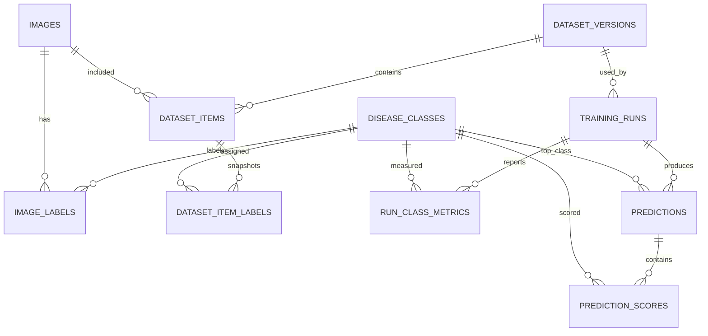

# Thiết kế cơ sở dữ liệu cho model phân loại bệnh da heo

Tài liệu này giúp nhóm thống nhất dữ liệu cần lưu khi quản lý ảnh, huấn luyện MobileNetV2 và ghi nhận kết quả dự đoán. Đây là thiết kế đề xuất; tool train hiện tại vẫn đọc ảnh qua manifest và chưa dùng cơ sở dữ liệu.

## 1. Cơ sở dữ liệu dùng để làm gì?

Cơ sở dữ liệu (CSDL) giữ thông tin có cấu trúc để nhóm trả lời được:

- Ảnh này nằm ở đâu, thuộc lớp nào, đã được ai rà soát chưa?
- Ảnh thuộc phiên bản dataset và tập train, validation hay test nào?
- Model được train bằng cấu hình, dữ liệu và mã lớp nào?
- Model đạt chỉ số nào trên validation và test?
- Một lần dự đoán dùng model nào, trả về lớp nào và điểm số bao nhiêu?

Ảnh và checkpoint `.pt`/`.pth` nên nằm trên ổ đĩa hoặc kho lưu trữ tệp. CSDL lưu đường dẫn và thông tin mô tả, không nhét toàn bộ ảnh hoặc trọng số model vào cột nhị phân. Việc train vẫn có thể đọc manifest CSV; CSDL giúp nhóm quản lý nguồn dữ liệu và lịch sử thí nghiệm.

## 2. Phạm vi model hiện tại

Thiết kế này dựa trên lượt MobileNetV2 đã chạy trong `PigSkinResearchStudio`:

| Mục | Giá trị hiện tại |
|---|---|
| Bài toán | Phân loại đơn nhãn ảnh bệnh da heo |
| Model | MobileNetV2, dùng ImageNet pretrained |
| Số lớp | 10 |
| Dataset trong manifest | 2.017 ảnh: train 1.576, validation 240, test 201 |
| Kích thước ảnh | 224 × 224 |
| Kết quả run hoàn chỉnh | Best epoch 12; validation macro-F1 0,7100; test macro-F1 0,6125; test accuracy 0,6219 |
| Thư mục run | `E:\code\PigSkinResearchStudio\ml_workspace\runs\20261028_190505` |

Điểm số trên là kết quả của một run, không phải nhãn chuẩn của từng ảnh và cũng không phải kết luận chẩn đoán. CSDL cần tách nhãn do con người xác nhận khỏi dự đoán của model.

Danh sách lớp lấy từ `data/splits/pig_skin_single_label_v4/classes.json`. Không nên viết cứng tên lớp trong nhiều bảng hoặc trong giao diện; bảng `disease_classes` là danh mục chuẩn.

## 3. Sơ đồ quan hệ



## 4. Các bảng cần có

| Bảng | Lưu gì? | Ghi chú |
|---|---|---|
| `disease_classes` | Mã lớp, tên hiển thị, tên tiếng Việt | Mã lớp ổn định; có thể dùng tên tiếng Anh từ class map làm `code`. |
| `images` | Đường dẫn ảnh, checksum, kích thước, nguồn | Lưu đường dẫn tương đối để đổi máy dễ hơn. |
| `image_labels` | Nhãn con người gán và trạng thái duyệt | Đây là nhãn dữ liệu, không phải dự đoán. |
| `dataset_versions` | Tên phiên bản, seed, manifest và checksum | Mỗi thay đổi nhãn hoặc cách chia tạo phiên bản mới. |
| `dataset_items` | Ảnh thuộc phiên bản nào, split nào, group nào | Một ảnh chỉ nằm trong một split của cùng phiên bản. |
| `dataset_item_labels` | Bản chụp nhãn được dùng trong phiên bản dataset | Giữ lại nhãn lịch sử nếu sau này sửa nhãn gốc. |
| `training_runs` | Model, cấu hình, trạng thái, đường dẫn checkpoint và metric tổng | JSON giữ cấu hình đầy đủ; cột riêng cho chỉ số thường cần lọc/sắp xếp. |
| `run_class_metrics` | Precision, recall, F1 từng lớp theo validation/test | Dùng tìm lớp model đang nhận diện kém. |
| `predictions` | Ảnh đưa vào, model run, lớp đứng đầu, điểm số và thời gian | `image_id` có thể để trống nếu ảnh chỉ được tải lên để thử. |
| `prediction_scores` | Điểm của từng lớp trong một lần dự đoán | Giữ đủ 10 điểm để xem các lớp model phân vân. |

## 5. Schema SQLite khởi đầu

Nhóm có thể tạo file `pig_skin.db` và chạy các câu lệnh dưới đây. Bật khóa ngoại trong mỗi kết nối SQLite bằng `PRAGMA foreign_keys = ON;`.

```sql
PRAGMA foreign_keys = ON;

CREATE TABLE disease_classes (
    class_id INTEGER PRIMARY KEY,
    code TEXT NOT NULL UNIQUE,
    name_vi TEXT NOT NULL,
    description TEXT
);

CREATE TABLE images (
    image_id INTEGER PRIMARY KEY,
    relative_path TEXT NOT NULL UNIQUE,
    sha256 TEXT UNIQUE,
    width INTEGER,
    height INTEGER,
    source TEXT,
    created_at TEXT NOT NULL DEFAULT CURRENT_TIMESTAMP
);

CREATE TABLE image_labels (
    image_label_id INTEGER PRIMARY KEY,
    image_id INTEGER NOT NULL REFERENCES images(image_id),
    class_id INTEGER NOT NULL REFERENCES disease_classes(class_id),
    review_status TEXT NOT NULL DEFAULT 'pending'
        CHECK (review_status IN ('pending', 'approved', 'rejected', 'needs_review')),
    annotator TEXT,
    reviewed_at TEXT,
    UNIQUE (image_id, class_id)
);

CREATE TABLE dataset_versions (
    dataset_id INTEGER PRIMARY KEY,
    name TEXT NOT NULL,
    version TEXT NOT NULL,
    manifest_path TEXT NOT NULL,
    manifest_sha256 TEXT,
    seed INTEGER,
    created_at TEXT NOT NULL DEFAULT CURRENT_TIMESTAMP,
    notes TEXT,
    UNIQUE (name, version)
);

CREATE TABLE dataset_items (
    dataset_item_id INTEGER PRIMARY KEY,
    dataset_id INTEGER NOT NULL REFERENCES dataset_versions(dataset_id),
    image_id INTEGER NOT NULL REFERENCES images(image_id),
    split TEXT NOT NULL CHECK (split IN ('train', 'val', 'test')),
    group_id TEXT,
    UNIQUE (dataset_id, image_id)
);

CREATE TABLE dataset_item_labels (
    dataset_item_id INTEGER NOT NULL REFERENCES dataset_items(dataset_item_id),
    class_id INTEGER NOT NULL REFERENCES disease_classes(class_id),
    PRIMARY KEY (dataset_item_id, class_id)
);

CREATE TABLE training_runs (
    run_id INTEGER PRIMARY KEY,
    dataset_id INTEGER NOT NULL REFERENCES dataset_versions(dataset_id),
    run_name TEXT NOT NULL UNIQUE,
    model_code TEXT NOT NULL,
    status TEXT NOT NULL CHECK (status IN ('running', 'completed', 'failed', 'cancelled')),
    config_json TEXT NOT NULL,
    checkpoint_path TEXT,
    best_epoch INTEGER,
    best_val_macro_f1 REAL,
    test_accuracy REAL,
    test_macro_f1 REAL,
    started_at TEXT,
    finished_at TEXT,
    notes TEXT
);

CREATE TABLE run_class_metrics (
    run_id INTEGER NOT NULL REFERENCES training_runs(run_id),
    split TEXT NOT NULL CHECK (split IN ('val', 'test')),
    class_id INTEGER NOT NULL REFERENCES disease_classes(class_id),
    precision REAL,
    recall REAL,
    f1 REAL,
    support INTEGER,
    PRIMARY KEY (run_id, split, class_id)
);

CREATE TABLE predictions (
    prediction_id INTEGER PRIMARY KEY,
    run_id INTEGER NOT NULL REFERENCES training_runs(run_id),
    image_id INTEGER REFERENCES images(image_id),
    input_uri TEXT,
    input_kind TEXT NOT NULL DEFAULT 'image'
        CHECK (input_kind IN ('image', 'video_frame')),
    frame_time_seconds REAL,
    predicted_class_id INTEGER REFERENCES disease_classes(class_id),
    top_score REAL,
    actual_class_id INTEGER REFERENCES disease_classes(class_id),
    review_status TEXT NOT NULL DEFAULT 'unreviewed'
        CHECK (review_status IN ('unreviewed', 'confirmed', 'incorrect', 'uncertain')),
    created_at TEXT NOT NULL DEFAULT CURRENT_TIMESTAMP
);

CREATE TABLE prediction_scores (
    prediction_id INTEGER NOT NULL REFERENCES predictions(prediction_id),
    class_id INTEGER NOT NULL REFERENCES disease_classes(class_id),
    score REAL NOT NULL CHECK (score >= 0 AND score <= 1),
    PRIMARY KEY (prediction_id, class_id)
);

CREATE INDEX idx_dataset_items_split ON dataset_items(dataset_id, split);
CREATE INDEX idx_predictions_run ON predictions(run_id, created_at);
CREATE INDEX idx_run_metrics_class ON run_class_metrics(class_id, split);
```

`actual_class_id` chỉ điền khi người có trách nhiệm xác nhận nhãn. Không chép `predicted_class_id` sang cột này để biến dự đoán thành ground truth.

## 6. Nạp dữ liệu hiện tại vào CSDL

Tool train dùng các tệp sau làm đầu vào và đầu ra:

```text
E:\code\PigSkinResearchStudio\data\splits\pig_skin_single_label_v4\manifest.csv
E:\code\PigSkinResearchStudio\data\splits\pig_skin_single_label_v4\classes.json
E:\code\PigSkinResearchStudio\ml_workspace\runs\20261028_190505\config.json
E:\code\PigSkinResearchStudio\ml_workspace\runs\20261028_190505\best_validation.json
E:\code\PigSkinResearchStudio\ml_workspace\runs\20261028_190505\final_metrics.json
```

Ánh xạ cột manifest:

| CSV hiện tại | Bảng/cột CSDL |
|---|---|
| `relative_path` | `images.relative_path` |
| `labels` | Tìm `class_id` theo `disease_classes.code`, ghi vào `image_labels` và `dataset_item_labels` |
| `split` | `dataset_items.split` (`valid` nếu có phải đổi thống nhất thành `val`) |
| `group_id` | `dataset_items.group_id` |
| SHA-256 | Tính khi nạp ảnh và lưu vào `images.sha256`; manifest hiện tại không có cột này |

Đường dẫn ảnh được ghép từ thư mục gốc dữ liệu đã chọn và `relative_path`. Không lưu đường dẫn máy cố định như `E:\...` vào `relative_path`.

Gợi ý nạp theo thứ tự:

1. Đọc `classes.json`, thêm đủ 10 lớp vào `disease_classes` và giữ nguyên `code`.
2. Tạo một dòng `dataset_versions` cho manifest đang dùng; lưu checksum SHA-256 thật của file manifest.
3. Với từng dòng CSV, thêm/tìm ảnh trong `images`, rồi tạo `dataset_items` và `dataset_item_labels`.
4. Nạp `config.json` và `final_metrics.json` thành một dòng `training_runs`; lưu đường dẫn checkpoint.
5. Đọc `best_validation.json` và `final_metrics.json` để thêm chỉ số mỗi lớp vào `run_class_metrics`.
6. Kiểm tra số dòng theo split và số ảnh theo lớp khớp manifest trước khi dùng CSDL.

Không điền `image_labels.review_status = 'approved'` cho toàn bộ dữ liệu nếu nhóm chưa thật sự rà và xác nhận nhãn. Nếu hiện trạng chỉ có nhãn nguồn từ dataset, ghi lại nguồn nhãn trong `notes` hoặc bổ sung cột `label_source` để phân biệt.

## 7. Cấu hình và chỉ số cần giữ

Trong `training_runs.config_json`, giữ nguyên toàn bộ cấu hình từ `config.json`, gồm tối thiểu:

- kiến trúc, chế độ nhãn và danh sách lớp;
- `image_size`, chuẩn hóa, augmentation và pretrained;
- epochs, head epochs, batch size, learning rates, weight decay, seed;
- device, phiên bản PyTorch/torchvision;
- đường dẫn manifest, checksum manifest và số lượng mỗi split.

Ở cột riêng, giữ `best_epoch`, `best_val_macro_f1`, `test_accuracy` và `test_macro_f1` để lọc/sắp xếp run. Giữ `precision`, `recall`, `f1`, `support` từng lớp trong `run_class_metrics`. Confusion matrix có thể lưu thêm dạng JSON gắn với run hoặc xuất thành tệp báo cáo.

Không dùng mỗi accuracy để chọn model. Với dữ liệu 10 lớp chưa cân bằng, cần xem macro-F1, recall từng lớp và confusion matrix cùng nhau.

## 8. Quy tắc nhóm cần thống nhất

Trước khi triển khai, nhóm điền các quyết định sau:

| Câu hỏi | Quyết định của nhóm |
|---|---|
| Chọn SQLite cho công cụ chạy một máy hay PostgreSQL cho nhiều người dùng đồng thời? | ........................................................ |
| Ai được quyền thêm/sửa nhãn đã duyệt? | ........................................................ |
| Ảnh tải lên để dự đoán có được lưu lâu dài không? | ........................................................ |
| Ai được quyền xem hoặc xóa lịch sử dự đoán? | ........................................................ |
| Mã lớp và tên tiếng Việt cuối cùng do ai xác nhận? | ........................................................ |
| Ảnh gốc sẽ lưu ở thư mục/kho nào, ai sao lưu? | ........................................................ |

Đề xuất cho bản đầu: dùng SQLite nếu nhóm làm demo trên một máy; dùng PostgreSQL nếu API và nhiều người cùng ghi dữ liệu. Giữ ảnh/checkpoint bên ngoài CSDL, còn CSDL lưu URI, cấu hình, metric và quan hệ giữa chúng.

## 9. Kiểm tra trước khi bàn giao

- [ ] Có đúng 10 mã lớp, mỗi mã duy nhất và khớp `classes.json`.
- [ ] Mỗi ảnh có đường dẫn tồn tại và không bị nhập trùng SHA-256 ngoài chủ ý.
- [ ] Mỗi ảnh chỉ thuộc một split trong một phiên bản dataset.
- [ ] Số ảnh train/val/test khớp 1.576/240/201 cho manifest này.
- [ ] Tổng số ảnh bằng 2.017; lớp và split được đối chiếu với manifest.
- [ ] Run có manifest hash, cấu hình, checkpoint, best epoch và metric test.
- [ ] Nhãn thật và dự đoán được lưu ở các cột/bảng riêng.
- [ ] Quyền lưu ảnh người dùng, thời hạn lưu và người phụ trách đã được thống nhất.

## 10. Phạm vi chưa có trong tool hiện tại

GUI train hiện lưu run dưới dạng thư mục có `config.json`, `history.csv`, `best_model.pt`, `best_validation.json` và `final_metrics.json`. Nó chưa tạo SQLite/PostgreSQL, chưa lưu lịch sử dự đoán vào database và chưa có quy trình xác nhận nhãn dự đoán. Tài liệu này là đặc tả để nhóm cùng rà soát trước khi viết phần kết nối CSDL.
