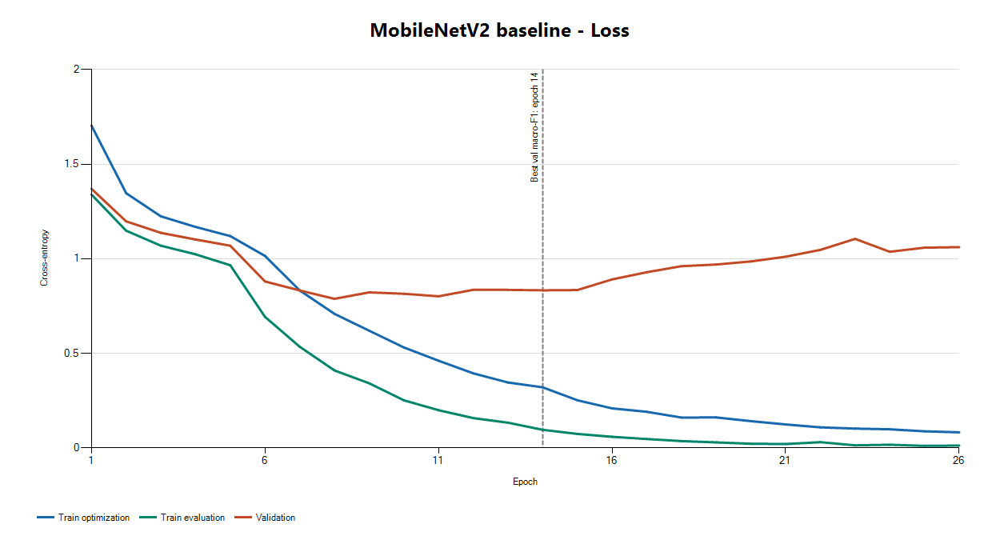
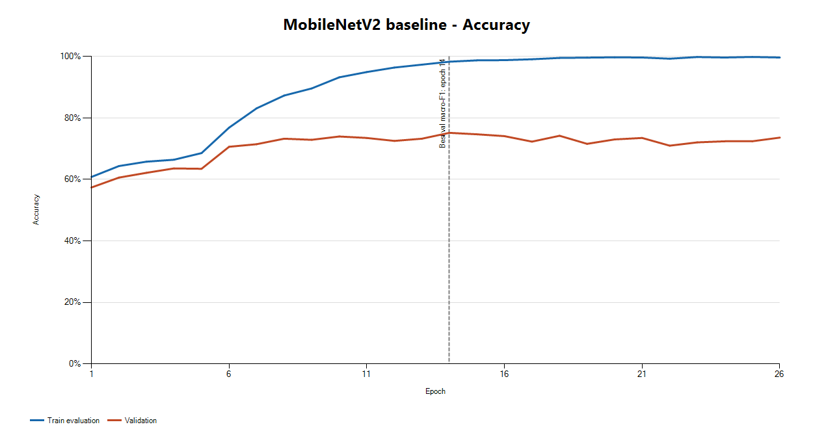
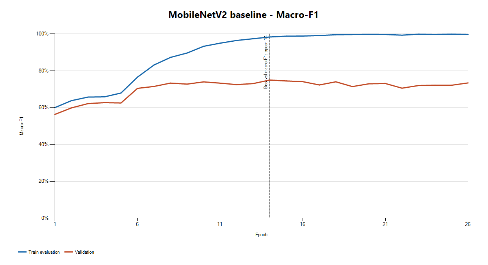

# PigSkinTech — Báo cáo tuần nhóm 5

**Đề tài:** Hỗ trợ sàng lọc dấu hiệu bệnh ngoài da ở heo bằng phân loại ảnh

**Mốc báo cáo:** 28/11/2026

**Phiên bản thí nghiệm:** `rf_v1_conservative_baseline_01`

## 1. Mục tiêu và dữ liệu

Tuần này nhóm kiểm tra dữ liệu Roboflow, thiết lập môi trường CUDA, chạy thử quy trình huấn luyện, huấn luyện baseline MobileNetV2 và đóng gói checkpoint để kiểm thử trong Flet. Tập Roboflow Pig Skin Disease Single Label v4 được xuất dưới dạng JPEG RGB 224×224. Nhóm đọc ảnh từ bản local và giữ ảnh gốc.

| Bước | Số ảnh còn dùng | Quyết định |
|---|---:|---|
| Bản xuất Roboflow | 4.979 | 10 lớp |
| Đợt sàng lọc đầu | 4.501 | Cách ly 345 ảnh nghi trùng và 133 ảnh thuộc 61 nhóm nghi mâu thuẫn nhãn |
| Manifest baseline | 4.413 | Tạm loại 88 ứng viên khỏi manifest gồm 79 ảnh từ audit và 9 ảnh quan sát trực quan |

dHash 256-bit so sánh cường độ của 16×16 cặp pixel lân cận sau khi chuẩn hóa ảnh xám thành 17×16. Hamming đếm số bit khác nhau giữa hai ảnh. Audit ngưỡng 12 tạo 37 thành phần liên thông, trong đó 19 nhóm xuyên split và 6 nhóm nghi khác nhãn. Ba nhóm có nối chuỗi với 6 cặp cách nhau hơn 12 bit. Báo cáo lưu từng cạnh và khoảng cách của mọi cặp cùng nhóm để người duyệt nhận biết lỗi nối chuỗi. Trường hợp V001 được đưa vào danh sách nhờ kiểm tra trực quan, dù Hamming là 51.

| Lớp | Train | Validation | Test |
|---|---:|---:|---:|
| Healthy | 340 | 90 | 39 |
| Erysipelas | 275 | 83 | 45 |
| Greasy Pig Disease | 316 | 88 | 36 |
| Environmental Dermatitis | 309 | 86 | 43 |
| Sunburn | 317 | 86 | 59 |
| Pityriasis Rosea | 337 | 73 | 46 |
| Ringworm | 320 | 82 | 43 |
| Mange | 332 | 90 | 34 |
| Foot and Mouth Disease | 284 | 77 | 28 |
| Swinepox | 322 | 83 | 50 |
| **Tổng** | **3.152** | **838** | **423** |

Manifest có đủ 10 lớp mỗi split. Các phép kiểm cho kết quả 0 trùng SHA-256, 0 group ID và 0 cặp dHash ở ngưỡng 12 xuyên split. Các nhóm liên quan khi được người duyệt xác nhận có thể gán chung `confirmed_group`. Manifest baseline giữ các split gốc của những ảnh còn lại.

## 2. Thiết lập và huấn luyện

Windows nhận RTX 5060 Laptop (compute capability 12.0), còn venv ứng dụng dùng PyTorch CPU. Môi trường train riêng dùng Python 3.10.5 x64, CUDA runtime 13.0, driver 591.86, torch 2.11.0+cu130, torchvision 0.26.0+cu130, NumPy 2.2.6, Pillow 12.3.0 và scikit-learn 1.7.1. Phép nhân ma trận và một bước Adam trên CUDA đều qua kiểm tra. Việc giữ cache, môi trường và output trên ổ D giải quyết lỗi dung lượng khi giải nén wheel.

MobileNetV2 sử dụng các khối inverted residual và linear bottleneck. Nhóm khởi tạo từ trọng số ImageNet, thay đầu ra thành 10 lớp, resize RGB 224×224 và chuẩn hóa bằng mean/std ImageNet. Pilot một epoch chạy trên dữ liệu thật với batch 16 và seed 123, đạt validation accuracy 64,32% và macro-F1 63,18%. Pilot dùng `--skip-test`.

Baseline khởi tạo lại từ ImageNet. Năm epoch đầu cập nhật classifier với LR 0,001. Giai đoạn fine-tune cập nhật toàn mạng với LR 0,0001. Adam dùng weight decay 0,0001 và CrossEntropyLoss. Augmentation train gồm lật ngang 0,5, xoay ±10°, brightness/contrast 0,1 và saturation 0,05. Seed 123, batch 16, workers 0. Trainer thực thi 26/30 epoch trên CUDA, mất 735 giây, cấp phát đỉnh 1.320,8 MiB và giữ đỉnh 1.458,0 MiB. Checkpoint 9.194.315 byte.

## 3. Đánh giá kỹ thuật

| Chỉ số | MobileNetV2 cũ `20261103_125653` | Roboflow baseline |
|---|---:|---:|
| Ảnh train / val / test | 1.575 / 240 / 201 | 3.152 / 838 / 423 |
| Epoch được chọn | 12 | 14 |
| Validation accuracy | 73,75% | 75,18% |
| Validation macro-F1 | 72,35% | 74,96% |
| Test accuracy | 64,18% | 71,87% |
| Test macro-precision | 63,76% | 72,51% |
| Test macro-recall | 63,61% | 72,85% |
| Test macro-F1 | 63,55% | 72,08% |

Hai cột là mô tả từng run trên hai tập test khác nhau. Cần một tập test chung độc lập với dữ liệu huấn luyện của cả hai để so sánh chất lượng. Baseline có 304 dự đoán đúng trên 423 ảnh, test loss 0,9179 và weighted precision/recall/F1 lần lượt 72,80% / 71,87% / 71,76%. Đối chiếu từng lớp, tổng hàng confusion matrix và trung bình có trọng số khớp artifact.

| Lớp | Precision | Recall | F1 | Support | FN |
|---|---:|---:|---:|---:|---:|
| Healthy | 88,64% | 100,00% | 93,98% | 39 | 0 |
| Erysipelas | 81,25% | 57,78% | 67,53% | 45 | 19 |
| Greasy Pig Disease | 58,97% | 63,89% | 61,33% | 36 | 13 |
| Environmental Dermatitis | 76,92% | 69,77% | 73,17% | 43 | 13 |
| Sunburn | 76,47% | 66,10% | 70,91% | 59 | 20 |
| Pityriasis Rosea | 63,27% | 67,39% | 65,26% | 46 | 15 |
| Ringworm | 72,22% | 60,47% | 65,82% | 43 | 17 |
| Mange | 55,10% | 79,41% | 65,06% | 34 | 7 |
| Foot and Mouth Disease | 80,00% | 85,71% | 82,76% | 28 | 4 |
| Swinepox | 72,22% | 78,00% | 75,00% | 50 | 11 |

Healthy đứng đầu theo F1. Greasy Pig Disease đứng cuối theo F1, Erysipelas có recall thấp nhất và Mange có precision thấp nhất. Các nhầm lẫn hai chiều đáng chú ý gồm Pityriasis Rosea ↔ Ringworm (7 + 5), Sunburn ↔ Greasy Pig Disease (6 + 4) và Greasy Pig Disease ↔ Mange (4 + 3). Trong 4 mẫu FMD dự đoán sai, 3 bị xếp vào Greasy Pig Disease và 1 vào Erysipelas. Trong 11 mẫu Swinepox dự đoán sai, 1 bị xếp Healthy. Các con số này đo sai phân loại so với nhãn tập ảnh, với support FMD chỉ 28.

Validation loss đạt khoảng 0,7881 ở epoch 8. Epoch 14 đạt macro-F1 validation cao nhất 0,7496 và accuracy 0,7518. Từ epoch 14 đến 26, train eval loss giảm từ 0,0955 xuống 0,0122 trong khi validation loss tăng từ 0,8330 lên 1,0612. Validation macro-F1 cuối là 0,7340. Trainer giữ epoch 14 theo tiêu chí đã định trước và chỉ dùng test sau khi chốt checkpoint.

## 4. Tích hợp, giới hạn và bước tiếp theo

Checkpoint Roboflow được đóng gói dưới một run riêng, có class mapping, config, metrics, history và confusion matrix. Giao diện quản trị hiển thị tên phiên bản và cho phép chọn lại checkpoint cũ. Xem hướng dẫn và phạm vi kiểm thử trong [tài liệu bàn giao](ROBOFLOW_HANDOFF.md).

- 1.260 ảnh còn cờ chất lượng và 79 ảnh được CLIP gắn cờ trong mẫu vẫn nằm trong manifest. Hai tập có thể chồng lấn. CLIP cho điểm tương đồng và có trường hợp nhầm ảnh thân thịt thành ảnh da người.
- 88 ảnh chỉ bị loại bảo thủ khỏi manifest thử nghiệm, chưa được xác nhận sai. Chuyên gia thú y chưa thẩm định toàn bộ nhãn.
- Trong đợt bàn giao tìm thấy bản local chứa đủ 2.016 đường dẫn của manifest cũ, với SHA-256 của manifest khớp config run của Phúc. So SHA-256 từng ảnh cho thấy **121 ảnh test mới trùng byte train cũ** và **124 ảnh test cũ trùng byte train mới**. Vì vậy dùng một trong hai test hiện hữu để so trực tiếp sẽ ưu ái ít nhất một model. So khớp tên file chỉ là tín hiệu tìm ứng viên. dHash có thể bỏ sót crop, lật, đổi góc và ảnh cùng nguồn hoặc phiên chụp.
- Ưu tiên tiếp theo là rà nguồn và nhãn, thu thập test độc lập, phân tích thêm lỗi FMD/Erysipelas và kiểm thử ứng dụng trên ảnh ngoài Roboflow. Accuracy và softmax là chỉ số của mô hình phân loại ảnh, không phải xác suất chẩn đoán lâm sàng. PigSkinTech phục vụ nghiên cứu và hỗ trợ sàng lọc.

## Tài liệu tham khảo

- Sandler và cộng sự, CVPR 2018. [MobileNetV2: Inverted Residuals and Linear Bottlenecks](https://openaccess.thecvf.com/content_cvpr_2018/html/Sandler_MobileNetV2_Inverted_Residuals_CVPR_2018_paper.html).
- Radford và cộng sự, ICML 2021. [Learning Transferable Visual Models From Natural Language Supervision](https://proceedings.mlr.press/v139/radford21a.html).
- PyTorch. [Bộ cài theo phiên bản](https://pytorch.org/get-started/previous-versions/) và [yêu cầu driver CUDA 13 cho Blackwell](https://pytorch.org/blog/pytorch-2-12-release-blog/).
- Roboflow. [Pig Skin Disease Single Label v4](https://universe.roboflow.com/final-dataset-pig-skin/pig-skin-disease-single-label-v4-bs402) và [phân biệt ảnh trùng chính xác và gần trùng](https://roboflow.com/ai/image-deduplication).
